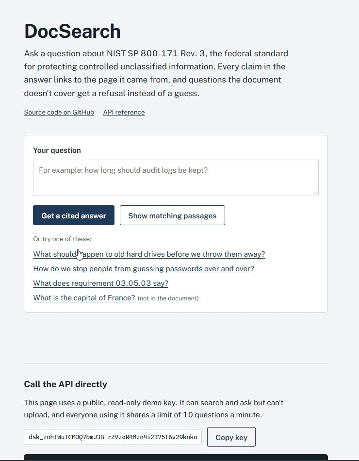
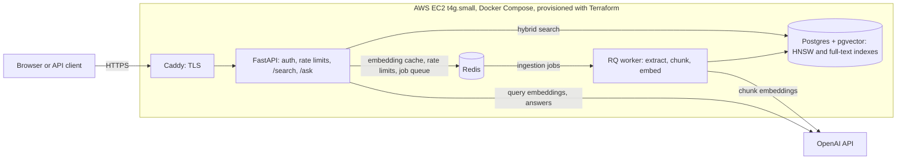

# DocSearch

A question-answering API over long documents. It finds the relevant passages with hybrid
keyword + vector search, answers with a language model that has to cite a page for every claim,
and refuses when the document doesn't cover the question.

**Try it:** **https://docsearch.mqazi98.com** (loaded with NIST SP 800-171 Rev. 3, a 120-page federal security standard)

## Results

| | |
|---|---|
| Retrieval quality | MRR@10 **0.716 → 0.807** (+12.7%) on the original 36 questions through A/B-tested changes; a later change took questions that mention a requirement ID inside a sentence from **0.021 to 0.202** |
| Answers | 42/42 in-scope questions answered, 41/42 cite a relevant page, **0 unsupported citations**, 4/5 out-of-scope questions refused |
| Latency (production) | ~14 ms retrieval with a cached query embedding; ~3 s to generate an answer |
| Cost | ~$5/month to host; ~$0.0004 per answer |
| Tests | 92, run in CI against real Postgres + pgvector and Redis |

The evaluation method and every experiment, including the one I rejected, are in [Evaluation](#evaluation).

## Architecture

**How a question is answered:** the question is embedded (or the embedding is read from the Redis
cache), then searched two ways at once: by meaning with pgvector and by keywords with Postgres
full-text search. The two rankings are merged with reciprocal rank fusion. Questions that look like
requirement IDs (`03.05.03`) skip the embedding and go straight to keyword search; when an ID appears
inside a sentence ("What does 03.05.03 say?"), the keyword search looks for the ID alone. The top passages
go to the model as numbered sources. Every citation in the answer is checked against the sources the
model was actually given, and the response reports the page for each one.

**How a document is ingested:** an upload returns `202` immediately. A background worker extracts
text page by page, splits it into 500-token chunks that never cross a page boundary, embeds them in
batches, and writes them in one transaction. Failures caused by a bad file stop for good; failures
from the network or the API retry with backoff.

## Run locally

    docker compose up --build
    python -m app.cli create-key --name me --role admin

Then open http://localhost:8000/docs, click **Authorize**, and paste the key.

### Development

    python -m venv .venv
    .venv\Scripts\activate            # macOS/Linux: source .venv/bin/activate
    pip install -r requirements-dev.txt
    pre-commit install

Dependencies are declared in `requirements.in` and `requirements-dev.in`, then compiled to exact
versions with `uv pip compile --universal`. The Docker image, CI, and local installs all get the same
versions, on Linux and Windows. To upgrade, recompile both files with `--upgrade`, run the tests,
and commit the results together.

Pre-commit runs ruff (lint and format), gitleaks (secret scanning), private-key detection, YAML checks,
and whitespace fixes before every commit.

## Design decisions

- **Separate liveness and readiness checks.** Liveness checks nothing external, so a database outage doesn't trigger container restarts; readiness returns 503 when a dependency is down so load balancers stop routing traffic.
- **Asynchronous ingestion with RQ.** Uploads return immediately; a worker extracts, chunks, and embeds in the background. The API and worker are the same image with different commands.
- **Idempotent, atomic ingestion.** Embeddings are computed before any writes, then all chunks commit in one transaction. Re-running a job replaces chunks rather than duplicating them, and already-ready documents are skipped.
- **Permanent vs. transient failures.** Bad documents (encrypted, no extractable text) fail once with a clear error; API and network errors are retried with backoff (10s, 30s, 60s).
- **Page-aware token chunking.** 500-token windows with 75-token overlap, measured with the embedding model's own tokenizer; chunks never cross pages, so every chunk can cite a page.
- **Provider-agnostic embeddings.** The pipeline depends on an `Embedder` interface; a deterministic fake embedder keeps tests offline and free.
- **Grounded answers with validated citations.** `/ask` retrieves via hybrid search, packs sources into a token budget, and instructs the model to answer only from numbered sources and cite every claim. Citations are parsed and checked against the sources actually provided; invalid references are reported, not hidden.
- **Explicit refusals.** The model must reply with a fixed sentence when sources don't contain the answer; with no retrieved sources, the API refuses without calling the model at all.
- **Prompt-injection hygiene.** Document text is wrapped in `<source>` tags, marked as data rather than instructions, and prevented from closing its own tag.
- **Separated latency.** Responses report `retrieval_ms` and `generation_ms` independently; upstream LLM failures return 502.
- **Pinned, reproducible builds.** Every direct and transitive dependency is pinned; dev pins are constrained to production pins, so CI tests exactly what ships.

## Evaluation

A labeled set of 42 questions over NIST SP 800-171r3 (8 bare control-ID lookups, 6 questions with a
control ID inside a sentence, 10 keyword queries, 10 paraphrases written to avoid the document's
wording, 8 natural questions) plus 5 out-of-scope questions. The six ID-in-sentence questions were
added for Experiment 4; the first three experiments ran on the original 36. Relevance is page-level: each question is labeled with control IDs, and the harness maps
controls to page spans from their headings, so labels survive re-chunking. The harness calls the same
service functions as the API. Run it with `python -m evaluation.run_eval --label <name> [--answers]`;
results are committed in `evaluation/results/`.

### Retrieval (hybrid search, original 36 questions)

| Configuration | hit@1 | hit@5 | MRR@10 |
|---|---|---|---|
| Keyword only | 0.389 | 0.639 | 0.504 |
| Vector only | 0.556 | 0.778 | 0.639 |
| Hybrid (RRF), baseline | 0.583 | 0.972 | 0.716 |
| + OR-style keyword leg | 0.639 | 0.972 | 0.747 |
| **+ identifier-aware routing (current)** | **0.694** | **1.000** | **0.807** |
| Heading-aware chunking (rejected) | 0.667 | 0.972 | 0.808 |

Each change was run as an A/B against a decision rule set before seeing results. Heading-aware
chunking improved vector-only MRR (0.639 → 0.718) but regressed keyword ranking because of
`ts_rank_cd`'s length bias; it failed the rule and is kept behind a flag, off. Re-running the
restored configuration reproduced identical results.

### Experiment 4: requirement IDs inside sentences (adopted)

Bare IDs like `03.05.03` were already routed to keyword search, but a question like "What does
requirement 03.05.03 say?" went through normal hybrid search, and the keyword leg searched every word
in the sentence. The change pulls ID-shaped terms out of the question and has the keyword leg search
only those; the vector leg still runs on the full question.

| ID-in-sentence questions (6), hybrid | hit@1 | hit@5 | hit@10 | MRR@10 |
|---|---|---|---|---|
| Before | 0.000 | 0.000 | 0.167 | 0.021 |
| **After (current)** | 0.000 | **0.667** | **1.000** | **0.202** |

Every other question type scored identically with the change on and off. Across all 42 questions,
hybrid MRR@10 went from 0.695 to 0.721 and hit@10 from 0.881 to 1.000. hit@1 is still 0: the correct
page now ranks 4th to 7th because reciprocal rank fusion interleaves the vector leg's unrelated results
above it. With the change on, all six questions produce answers that cite the labeled page. Details are
in [retrieval-notes](docs/retrieval-notes.md).

### Answers (`/ask`, current configuration, 42 questions)

| Metric | Value |
|---|---|
| In-scope questions answered | 42/42 (100%) |
| Citation accuracy (≥1 citation on a relevant page) | 41/42 (97.6%) |
| Unsupported citations | 0 |
| Out-of-scope questions correctly refused | 4/5 (80%) |
| Generation latency p50 / p95 | 2.0 s / 3.1 s |
| Average tokens per answer | 3,273 input / 112 output |

The citation miss is "What should happen to old hard drives before we throw them away?" The answer is
correct (sanitize before disposal), but it cites page 54 instead of the media sanitization requirement on
page 55. The refusal miss is "How do I reset my Windows password?": instead of refusing, the model says
the document has no Windows steps and then cites the document's password-recovery guidance.

Answer metrics come from a non-deterministic model and vary slightly between runs. Retrieval metrics are
deterministic and reproduce exactly.

### Latency
Search (warm query cache): keyword ~4 ms, hybrid ~51 ms p50. Cold query embedding ~170 ms p50.
Identifier-shaped queries skip the embedding call entirely.

## Security

### API keys
- Every endpoint except `/health` requires an `X-API-Key` header.
- Two roles: **admin** can upload and reprocess documents. **reader** can list documents, search, and ask.
- A missing or invalid key returns `401`. A valid key with the wrong role returns `403`.
- Keys are `dsk_` plus 32 random bytes, generated with `secrets.token_urlsafe`. Only the SHA-256 hash is stored, so the full key is shown once at creation and can't be recovered from the database.
- I used SHA-256 instead of bcrypt on purpose. bcrypt's slowness protects low-entropy human passwords. These keys carry 256 bits of randomness, so brute-forcing a leaked hash isn't feasible, and a fast hash keeps per-request lookups cheap (a single indexed equality match).
- Revoking a key takes effect on the next request.
- `last_used_at` is written at most once per minute per key, so normal traffic doesn't cause a database write on every request.
- Keys are managed with a CLI: `python -m app.cli create-key | list-keys | revoke-key`.

### Rate limits
Limits are fixed-window counters in Redis (`INCR` + `EXPIRE` in one transaction), applied per key. Responses over the limit get `429` with `Retry-After`.

| Endpoint | Limit | If Redis is down |
|---|---|---|
| `GET /search` | 60/min per key | **Fails open.** Search costs one cached embedding at most, so availability matters more. |
| `POST /ask` | 10/min per key, plus 500/day across all keys | **Fails closed (503).** Every call costs money, so an unprotected window isn't acceptable. |

The global daily cap on `/ask` puts a hard ceiling on LLM spend even if many keys are active. The OpenAI account is prepaid with auto-reload off, which adds a second backstop.

**Known trade-off:** a fixed window lets a client send up to 2× the limit across a window boundary. A sliding window or token bucket would fix that. At this traffic level, the simpler and cheaper implementation is the better call.

**Not in scope:** key expiry and rotation, per-key custom quotas, OAuth/user accounts.

## Deployment

Live at **https://docsearch.mqazi98.com/docs**

### Architecture
One `t4g.small` EC2 instance (2 vCPU ARM, 2 GB RAM) runs the full stack in Docker Compose:
Caddy (TLS) → FastAPI → Postgres + pgvector, Redis, and an RQ worker. Infrastructure is defined in
Terraform (`infra/`): a dedicated VPC with one public subnet, a security group allowing only 80/443,
an Elastic IP, and a Route 53 record.

### Decisions
- **No SSH.** Port 22 is closed; shell access goes through SSM Session Manager using IAM Identity
  Center credentials with MFA. There's no key pair to leak and no port to scan.
- **Secrets never touch Git or Terraform.** The OpenAI key and Postgres password live in SSM Parameter
  Store (SecureString). The deploy script writes them to a root-only `.env.prod` on the host. Terraform
  state stores values in plain text, so secrets stay out of it entirely.
- **Only Caddy is exposed.** Postgres, Redis, and the API are reachable only on Docker's internal network.
  Caddy obtains and renews Let's Encrypt certificates automatically and redirects HTTP to HTTPS.
- **IMDSv2 required, encrypted root volume, standard CPU credits** (throttles instead of billing for
  burst credits).
- **Cost: about $5/month** (EBS + public IPv4; the instance is on AWS's t4g free trial through 2026).
  The managed equivalent (ALB, NAT gateway, RDS, ElastiCache, Fargate) would cost over $100/month before
  any traffic. Spending is capped by a $10 AWS budget alert, the API's 500-per-day `/ask` limit, and a
  prepaid OpenAI balance with auto-reload off.

### Production measurements (single requests, t4g.small)
| Measurement | Value |
|---|---|
| Hybrid retrieval, cold (includes OpenAI embedding call) | ~1.4 s |
| Hybrid retrieval, cached query embedding (Redis) | ~14 ms |
| Identifier search (`03.05.03`, keyword-routed) | ~14 ms |
| Answer generation | ~2.8–3.5 s |
| Tokens per answer | ~3.7K input / ~60–90 output |
| Cost per answer | ~$0.0004 |

Single-request timings from the live deployment, not a load test. The evaluation harness above reports
generation p50/p95 across the full 42-question set.

### Verified
- HTTP redirects to HTTPS; certificate issued by Let's Encrypt
- Port 443 open; ports 22, 5432, and 6379 unreachable from the internet
- Reader key: search and ask succeed, upload returns 403

### Deploying
    # on the server, via Session Manager:
    sudo bash /opt/docsearch/deploy/deploy.sh          # pulls main, rebuilds, restarts

### Teardown
    cd infra && terraform destroy
